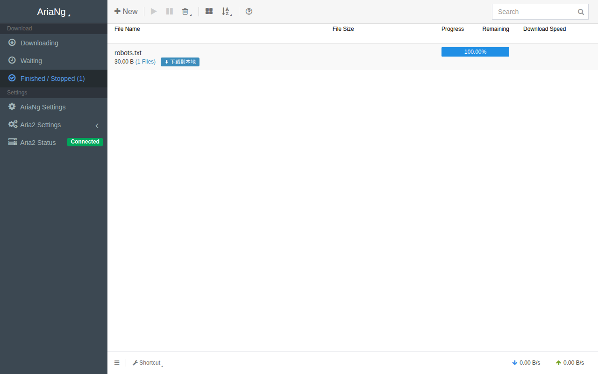

# aria2-one: 单端口 Aria2 控制台服务

真正的单端口纯粹下载控制台容器镜像。仅暴露唯一的 Web 端口（默认 8080），内置前置 Basic Auth 统一鉴权、同源自适应零配置连接、直链本地下载与流媒体在线预览，并通过内部 Go 中间件实现删除任务时自动彻底清理磁盘关联文件，同时内置 GitHub Release 定期镜像。



## 核心特性

1. **真正单端口暴露**：对外仅需开放 8080 端口，前端 AriaNg、下载直链与内部 RPC 全由前置 Nginx 智能分流。内部关闭 6800 端口暴露，安全清爽。
2. **同源零配置自适应**：前端自适应识别当前访问的 Hostname/Port/Protocol 直连 `/jsonrpc`，换 IP、换域名、反代均 100% 自动成功连接。
3. **下载直链与媒体预览**：已完成任务一键拉回本地电脑，多文件任务支持逐个下载并支持音视频/图片直接在线流式播放预览。
4. **一致性物理删除**：通过内部 `aria2-controller` 透明拦截删除指令，移除任务时自动物理删除对应磁盘文件与伴生 `.aria2` 文件，并递归清理空目录。
5. **BT Tracker 自动更新**：容器启动自动拉取最新优质 Trackers，支持每日凌晨通过 RPC 无感热重载。
6. **PUID/PGID 权限支持**：灵活映射宿主机权限，杜绝权限冲突。
7. **GitHub Release 定期镜像**：侧边栏「Release 镜像」页面可视化管理要跟踪的仓库，内置调度器定时检查最新 Release，按后缀 / 正则筛选资产后交给 aria2 多线程下载并自动保存 CHANGELOG，支持一键导入旧版 `github-release-mirror` 脚本的 `config.yaml`。

## 快速使用

### Docker Compose (推荐)

```yaml
services:
  aria2:
    image: flintylemming/aria2-one:latest
    container_name: aria2-one
    restart: unless-stopped
    ports:
      - "8080:8080"
      - "32516:32516"
      - "32516:32516/udp"
    environment:
      - USERNAME=admin
      - PASSWORD=admin888
      - PUID=1000
      - PGID=1000
      - TZ=Asia/Shanghai
      # - GITHUB_TOKEN=
    volumes:
      - ./config:/config
      - ./downloads:/downloads
```

打开浏览器访问 `http://<服务器IP>:8080`，输入设定的账号密码即可畅快使用。

## 环境变量说明

| 变量名 | 默认值 | 作用描述 |
| :--- | :--- | :--- |
| `PORT` | `8080` | 控制台对外访问端口 |
| `BTPORT` | `32516` | BT/DHT 监听端口 (TCP/UDP) |
| `USERNAME` | `admin` | 控制台登录用户名 (留空关闭鉴权) |
| `PASSWORD` | `admin888` | 控制台登录密码 |
| `PUID` | `1000` | 运行用户的 UID |
| `PGID` | `1000` | 运行用户的 GID |
| `TZ` | `Asia/Shanghai` | 时区 |
| `CACHE` | `128M` | Aria2 写入缓存 |
| `UT` | `true` | 启动时是否自动拉取最新 Trackers |
| `RUT` | `true` | 是否开启每日凌晨定时热更新 Trackers |
| `GITHUB_TOKEN` | 空 | 可选，Release 镜像访问 GitHub API 时使用的 Token，仅用于提高 API 限额（面板设置中填写的 Token 优先） |

> 高级：`GITHUB_API_URL`（默认 `https://api.github.com`）可将 Release 镜像指向兼容 GitHub API 的服务，主要用于测试，一般无需设置。

## GitHub Release 镜像

把原先依赖 cron 运行的 `github-release-mirror` 脚本内置到了控制台中：定时检查仓库的最新 Release，把需要的资产下载到 `/downloads` 下，并通过直链提供。

### 打开页面

登录控制台后，点击左侧边栏 **GitHub → Release 镜像**（也可直接访问 `http://<服务器IP>:8080/#!/mirrors`）。顶部工具条提供「添加镜像」「全部检查」「导入 YAML」「设置」。

### 添加镜像

点击「添加镜像」并填写：

| 字段 | 说明 |
| :--- | :--- |
| 名称 | 列表中的显示名，留空时取仓库名 |
| 仓库 | `owner/name`，也可以直接粘贴 `https://github.com/owner/name` 链接（带 `.git`、`/releases` 等后缀均可，会自动规范化） |
| 文件夹 | 保存目录名，留空时取仓库名；各镜像之间不可重复（不区分大小写） |
| 文件后缀 | 只下载指定后缀的资产，逗号或空格分隔，如 `exe, msi`，也可写 `tar.gz`；不区分大小写，前导 `.` 可省略 |
| 正则 | 只下载文件名匹配该正则的资产。采用 Go RE2 语法、**部分匹配**：`(osx\|win)` 能匹配 `app-win-x64.zip`，需要从开头匹配请自行加 `^` |
| 包含预发布 | 勾选后取最近发布的 Release（含 Pre-release），否则只取最新正式版；草稿始终忽略 |
| 保存 CHANGELOG | 把 Release 说明写入版本目录下的 `CHANGELOG.md`（已存在则不覆盖） |
| 保留版本数 | 新版本的文件全部下载完成后，只保留最近 N 个版本目录（含当前版本），`0` 表示全部保留 |
| 启用 | 关闭后不参与定时检查与「全部检查」 |

文件后缀与正则同时设置时须同时满足；两者都留空则下载该 Release 的全部资产。新建并启用的镜像会立即检查一次。

### 同步机制

- 每个镜像只镜像**最新**的一个 Release，不回溯下载历史版本：本地缺少的文件会投递下载，已完整存在的文件直接跳过，同名但大小不一致的文件（如资产被重新上传）会重新完整下载；旧版本只有在曾经同步过时才会保留在磁盘上。
- 资产下载直接交给 aria2 完成（多线程、断点续传），进度在 AriaNg 任务列表中同样可见；下载失败的文件会在镜像页面显示 aria2 给出的失败原因，并在下一次检查时自动重试。
- 状态标签：灰色为尚未检查，蓝色为检查 / 下载中，绿色为已同步，黄色为文件不完整（下次检查自动重试），红色为出错（会显示原因，例如 API 限流、仓库不存在或没有正式 Release）。

### 设置

| 设置项 | 说明 |
| :--- | :--- |
| 根目录 | 默认 `github-mirror`，即 `/downloads/github-mirror`；必须是 `/downloads` 下的相对路径，允许多级 |
| 检查间隔 | 单位分钟，默认 `360`（6 小时），范围 `10` ~ `43200`；填 `0` 表示仅手动检查 |
| HTTP 代理 | 访问 GitHub API 与下载资产时使用，格式 `http://[user:pass@]host[:port]`（aria2 仅支持 HTTP 代理）；留空直连，不读取容器的代理环境变量 |
| GitHub Token | 可选，**仅用于把 API 限额从 60 次/小时提升到 5000 次/小时**，无需勾选任何权限；**不支持私有仓库**。保存后不会在页面或 API 中回显，留空保持不变，勾选「清除 Token」可删除；未填写时使用环境变量 `GITHUB_TOKEN` |

修改根目录或镜像的文件夹不会移动已经下载的文件。

### 目录结构与直链

磁盘布局与原脚本一致：

```text
/downloads/github-mirror/
└── PowerToys/                      ← 镜像的「文件夹」
    └── v0.85.1/                    ← Release tag
        ├── CHANGELOG.md
        └── PowerToysSetup-0.85.1-x64.exe
```

对应直链为 `http://<服务器IP>:8080/download/github-mirror/PowerToys/v0.85.1/PowerToysSetup-0.85.1-x64.exe`（同样受 Basic Auth 保护）。在镜像列表中点击「版本」可列出所有已镜像的版本及文件直链（尚未下载完成的文件标记为「未完成」，不提供直链）。把旧脚本 `saved-path` 下的内容放到 `downloads/github-mirror/` 中即可直接沿用，已完整存在的文件不会重复下载。

### 删除保护

镜像目录（`/downloads/<根目录>/`）中的文件**不受**「一致性物理删除」影响：在 AriaNg 任务列表里删除镜像产生的下载任务，只会移除任务记录，文件保留。镜像文件请通过镜像页面管理——用「保留版本数」自动清理旧版本，或在删除镜像时勾选「同时删除已下载的文件」。删除镜像会同时停止它正在进行的同步与下载任务。

### 从旧脚本导入

点击「导入 YAML」，粘贴原脚本 `config.yaml` 的全部内容：

- 只读取 `track-list`：节点名 → 名称，`repo-info` → 仓库，`folder-name` → 文件夹，`get-changes-info` → 保存 CHANGELOG，`file-type` → 文件后缀，`regex` → 正则；`saved-path`、`proxy`、`run-as-root` / `fix-chown` 等其余配置会被忽略（代理请在「设置」中填写）。
- 原脚本使用 Python 的 `re.match`（从文件名开头匹配），导入时正则会自动转换为 `^(?:原正则)`，保持匹配结果一致。
- 被注释掉的条目不会导入；校验失败或与已有镜像文件夹重复的条目会被跳过，并显示原因。
- 导入的镜像默认启用。导入本身不触发同步；若检查间隔不为 `0`，调度器会在约 30 秒内依次检查这些从未检查过的镜像（每个镜像一次 API 请求）。想先调整再同步，可先把检查间隔设为 `0`，或在导入后停用相应条目。

### 配置存储

镜像列表、设置（含 Token）与同步状态保存在 `/config/github-mirror.json`（权限 `0600`），随 `/config` 卷持久化。

## 常见问题

- **Docker Desktop（Windows / macOS）下大文件下载失败，报 `fallocate failed` / `Operation not supported`**：默认 aria2 配置使用 `file-allocation=falloc`，而 Docker Desktop 的绑定挂载（bind mount）目录不支持 fallocate。请在 `/config/aria2.conf` 中改为 `file-allocation=none`（或 `prealloc`）后重启容器。
